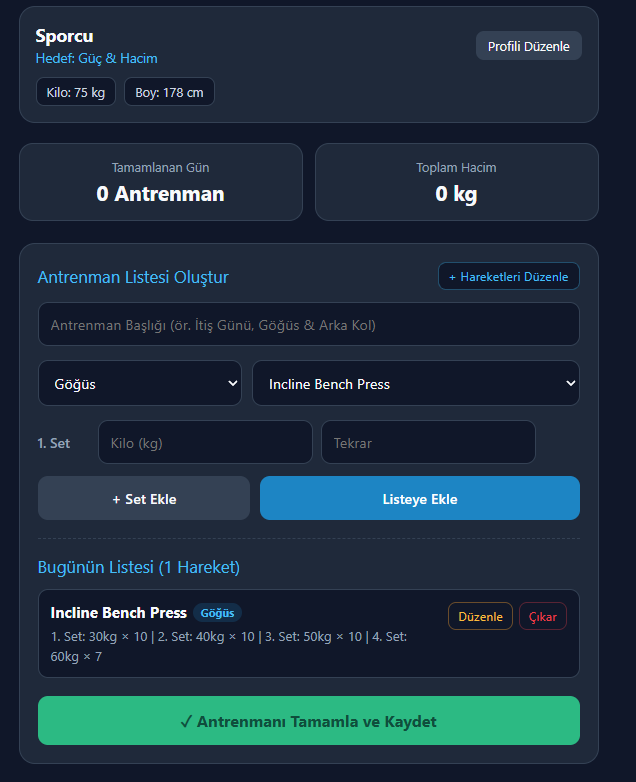

# Antrenman Günlüğüm (Workout Tracker)

**Antrenman Günlüğüm**, spor salonu ve bireysel antrenman süreçlerini dijital ortamda takip etmek amacıyla React ve Vite kullanılarak geliştirilmiş, mobil uyumlu (Mobile-First) modern bir web uygulamasıdır. Kullanıcıların profil bilgilerini yönetmesine, kas gruplarına göre sınıflandırılmış hareket kütüphanesinden seçim yapmasına, her set için farklı ağırlık/tekrar değerleri girmesine ve tamamlanan antrenmanları günlük programlar halinde tarayıcı hafızasında (`LocalStorage`) saklamasına olanak tanır.

## Uygulama Ekran Görüntüsü


## Temel Özellikler
- **Kullanıcı Profili Yönetimi:** Kullanıcının isim, güncel kilo, boy ve antrenman hedefi bilgilerini kaydedebilmesi ve dilediği zaman güncelleyebilmesi.
- **Sınıflandırılmış Hareket Kütüphanesi:** Göğüs, Sırt, Bacak, Omuz, Kol ve Karın/Kardiyo kategorileri altında hazır hareket listesi sunması; ayrıca kullanıcının kütüphaneye kendi özel hareketlerini ekleyip çıkarabilmesi.
- **Set Bazlı Farklı Ağırlık ve Tekrar Girişi:** Tek bir harekete ait her set için ayrı ağırlık (kg) ve tekrar sayısı tanımlayabilme, bir önceki setin verilerini otomatik kopyalama.
- **Günlük Antrenman Taslağı ve Düzenleme:** Antrenman sırasında eklenen hareketleri taslak listede görebilme, mevcut hareketlerin set ve ağırlıklarını düzenleyebilme ve antrenman bitiminde tüm günü tek bir kart altında arşive kaydetme.
- **Kalıcı Veri Saklama (LocalStorage):** Eklenen tüm profil bilgileri, özel hareketler ve geçmiş antrenman kayıtlarının sayfa yenilense dahi tarayıcı hafızasında korunması.

## Kullanılan Teknolojiler
- **React 18+:** Bileşen tabanlı kullanıcı arayüzü ve durum (state) yönetimi (`useState`, `useEffect`).
- **Vite:** Hızlı geliştirme ortamı ve proje derleme (build) aracı.
- **CSS3 (Custom Dark Theme & Responsive Grid/Flexbox):** Mobil ve masaüstü ekranlara uyumlu koyu temalı arayüz tasarımı.
- **Web Storage API (`LocalStorage`):** Sunucusuz, tarayıcı tabanlı kalıcı veri depolama.
- **GitHub & Vercel:** Sürüm kontrolü ve bulut tabanlı canlı yayınlama (deployment).

## Kurulum ve Çalıştırma Adımları

Projeyi yerel bilgisayarınızda çalıştırmak için aşağıdaki adımları izleyin:

```bash
git clone <GITHUB_REPO_LINKINIZ>
cd antrenman-takip
npm install
npm run dev
