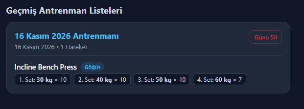

# Antrenman Günlüğüm (Workout Tracker)

Modern web teknolojileri ve yapay zeka desteğiyle geliştirilmiş, kullanıcı profili yönetimi, sınıflandırılmış hareket kütüphanesi ve set bazlı ağırlık takibi sunan mobil uyumlu web uygulamasıdır.

## Ekran Görüntüsü



## Özellikler
- **Kullanıcı Profili:** İsim, kilo, boy ve antrenman hedefi bilgilerini kaydetme ve düzenleme.
- **Sınıflandırılmış Hareket Kütüphanesi:** Kas gruplarına (Göğüs, Sırt, Bacak, Omuz, Kol, Karın/Kardiyo) göre filtrelenen hazır hareketler ve kütüphaneye özel hareket ekleme/çıkarma.
- **Set Bazlı Farklı Ağırlık Girişi:** Her set için ayrı ağırlık ve tekrar sayısı belirleme, taslak listeyi düzenleme.
- **Günlük Antrenman Arşivi & LocalStorage:** Tamamlanan antrenmanları tek bir gün kartı altında toplama ve tarayıcı hafızasında kalıcı olarak saklama.

## Kullanılan Teknolojiler
- **React (Vite)**
- **Modern CSS3 (Mobile-First Responsive Tasarım)**
- **Web Storage API (LocalStorage)**

## Kurulum ve Çalıştırma
```bash
git clone <github-repo-linkiniz>
cd antrenman-takip
npm install
npm run dev